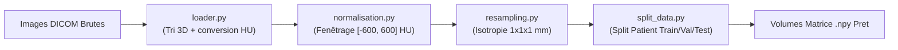

# 📌 Module O1 : Prétraitement & Normalisation des Données CTPA

---

## 💡 Le Module O1 en 2 Mots (Pour tous)

Imaginez qu'on reçoive des photos médicales prises par des appareils photo différents, sous des éclairages variés et avec des zooms différents. Si on essaie de comparer directement ces images, l'ordinateur sera désorienté. 

Le **Module O1** agit comme une **station de calibration automatique** : il nettoie, convertit les mesures physiques en vraies densités de tissus humains, harmonise la taille des voxels (pixels 3D) et découpe proprement le jeu de données pour que l'Intelligence Artificielle travaille sur des bases solides et standardisées.

---

## 🎯 Enjeux & Rôle dans le Projet

* **Normalisation Hounsfield (HU)** : Les scanners DICOM utilisent une échelle physique absolue. L'air vaut environ `-1000 HU`, l'eau `0 HU`, les poumons `-600 HU` et les os/contraste `+300 HU` à `+1000 HU`. Ce module isole la fenêtre d'intérêt `[-600, +600 HU]` optimale pour observer le parenchyme pulmonaire et le réseau artériel.
* **Isotropie Spatiale** : Les tranches de scanner n'ont pas toujours le même espacement entre les coupes (ex: `0.7mm x 0.7mm` en 2D mais `2.5mm` entre tranches). Le rééchantillonnage transforme le volume en voxels cubiques parfaits `1mm x 1mm x 1mm`.
* **Sécurité Anti-Fuite (Data Leakage)** : Découpe les jeux de données (Entraînement / Validation / Test) **au niveau patient** pour éviter de placer deux coupes du même patient dans l'entraînement et dans le test.

---

## 📂 Contenu du Package `src/O1_preprocessing/`

| Fichier Python | Rôle & Contenu Concret |
| :--- | :--- |
| [`loader.py`](file:///f:/Nouveau%20dossier/Projets/Projet_detection_embolie_pulmonaire/src/O1_preprocessing/loader.py) | Charge les séries de tranches DICOM ou fichiers `.mat`, réordonne la géométrie 3D selon la position du patient (`ImagePositionPatient`), et applique la conversion `Pixel * Slope + Intercept`. |
| [`normalisation.py`](file:///f:/Nouveau%20dossier/Projets/Projet_detection_embolie_pulmonaire/src/O1_preprocessing/normalisation.py) | Applique le fenêtrage d'intensité pulmonaire/vasculaire (`min_hu=-600`, `max_hu=600`) et ramène les intensités entre `0.0` et `1.0`. |
| [`resampling.py`](file:///f:/Nouveau%20dossier/Projets/Projet_detection_embolie_pulmonaire/src/O1_preprocessing/resampling.py) | Rééchantillonne le volume 3D via interpolation spline order 1/3 pour uniformiser l'espacement voxélique (ex: `[1.0, 1.0, 1.0] mm`). |
| [`split_data.py`](file:///f:/Nouveau%20dossier/Projets/Projet_detection_embolie_pulmonaire/src/O1_preprocessing/split_data.py) | Effectue la répartition stratifiée au niveau Patient (70% Train, 15% Val, 15% Test) avec sauvegarde des sous-dossiers. |

---

## 🔄 Pipeline d'Exécution



---

## 📥 Entrées & 📤 Sorties

* **Entrée** : Dossiers de coupes DICOM (`.dcm`) ou fichiers Matlab (`.mat`) contenant les volumes de scanners thoraciques.
* **Sortie** : Fichiers NumPy `.npy` prêts pour le calcul (volumes 3D normalisés entre `0.0` et `1.0`, masques rééchantillonnés, et fichiers de configuration de split `train_patients.json`).

---

## 🚀 Exemple d'Utilisation Rapide

```python
from src.O1_preprocessing.loader import load_dicom_volume
from src.O1_preprocessing.normalisation import normalize_hu
from src.O1_preprocessing.resampling import resample_volume

# 1. Charger le volume DICOM
volume_hu, metadata = load_dicom_volume("data/raw/PAT001/")

# 2. Normaliser les intensités
volume_norm = normalize_hu(volume_hu, min_hu=-600, max_hu=600)

# 3. Rééchantillonner en 1mm x 1mm x 1mm
volume_iso, new_spacing = resample_volume(volume_norm, current_spacing=metadata['spacing'], target_spacing=[1.0, 1.0, 1.0])
```
