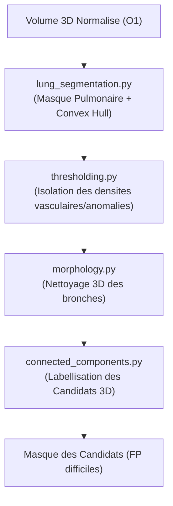

# 📌 Module O2 : Détection Classique & Segmentation Pulmonaire

---

## 💡 Le Module O2 en 2 Mots (Pour tous)

Une fois le scanner nettoyé par O1, le **Module O2** joue le rôle d'un **filtre de présélection automatique** : 
1. Il détourera d'abord les deux poumons pour éliminer tout le reste du corps (os, cœur, muscle, air extérieur).
2. Il appliquera la technique de l'**Enveloppe Convexe (Convex Hull)** pour englober les hiles vasculaires centraux (là où les artères pulmonaires principales se trouvent).
3. Il recherchera les anomalies de contraste (zones suspectes) pour générer une liste de **"candidats" à l'embolie**.

---

## 🎯 Enjeux & Rôle dans le Projet

* **Segmentation Pulmonaire Robuste avec Enveloppe Convexe** : Les algorithmes basiques de seuillage coupent les hiles pulmonaires (car les gros vaisseaux y sont très denses). L'intégration de `convex_hull_image` permet de combler cette encoche anatomique et de ne jamais manquer les embolies centrales majeures.
* **Le "Paradoxe du Donut" & Hard Negative Mining** : 
  * Une embolie pulmonaire sur CTPA est une zone de sang trombotique **sombre** (20-100 HU) encerclée par du produit de contraste **très brillant** (150-400 HU) dans l'artère.
  * Le seuillage classique extrait donc beaucoup de petits vaisseaux ou structures bronchiques qui ressemblent visuellement à des embolies.
  * **Solution stratégique** : Les candidats générés par O2 servent de **Faux Positifs difficiles (Hard Negatives)**. Associés au Ground Truth (VP), ils construisent un dataset équilibré et ultra-discriminant pour le Machine Learning (O3/O4).

---

## 📂 Contenu du Package `src/O2_classical_detection/`

| Fichier Python | Rôle & Contenu Concret |
| :--- | :--- |
| [`lung_segmentation.py`](file:///f:/Nouveau%20dossier/Projets/Projet_detection_embolie_pulmonaire/src/O2_classical_detection/lung_segmentation.py) | Algorithme principal de détourage 3D des poumons (Seuillage Otsu/Adaptatif + Enveloppe Convexe `convex_hull` + Nettoyage des bordures). |
| [`thresholding.py`](file:///f:/Nouveau%20dossier/Projets/Projet_detection_embolie_pulmonaire/src/O2_classical_detection/thresholding.py) | Seuillage adaptatif local et global pour isoler les structures denses et les défauts de remplissage intrachambre/intravasculaire. |
| [`morphology.py`](file:///f:/Nouveau%20dossier/Projets/Projet_detection_embolie_pulmonaire/src/O2_classical_detection/morphology.py) | Opérations de morphologie mathématique 3D (ouverture, fermeture, érosion, dilatation) pour séparer les bronches des vaisseaux. |
| [`connected_components.py`](file:///f:/Nouveau%20dossier/Projets/Projet_detection_embolie_pulmonaire/src/O2_classical_detection/connected_components.py) | Analyse des composantes connexes 3D (`scipy.ndimage.label`) pour attribuer un identifiant unique à chaque candidat et filtrer par volume. |
| [`detector.py`](file:///f:/Nouveau%20dossier/Projets/Projet_detection_embolie_pulmonaire/src/O2_classical_detection/detector.py) | Pipeline orchestratrice combinant segmentation, seuillage et extraction des régions d'intérêt (ROI). |

---

## 🔄 Pipeline d'Exécution



---

## 📥 Entrées & 📤 Sorties

* **Entrée** : Volume 3D normalisé issu d'O1 (`volume.npy`).
* **Sortie** : 
  * `lung_mask.npy` : Masque binaire 3D des poumons entiers (avec hiles).
  * `candidates.npy` : Masque 3D étiqueté (chaque objet candidat possède un ID entier 1, 2, 3...).

---

## 🚀 Exemple d'Utilisation Rapide

```python
from src.O2_classical_detection.lung_segmentation import segment_lungs
from src.O2_classical_detection.connected_components import extract_candidates

# 1. Obtenir le masque pulmonaire complet
lung_mask = segment_lungs(volume_norm, method='threshold', hu_threshold=-400)

# 2. Extraire et étiqueter les candidats emboliques
candidates_mask, num_candidates = extract_candidates(volume_norm, lung_mask, min_volume_mm3=20)
print(f"Nombre de candidats détectés : {num_candidates}")
```
