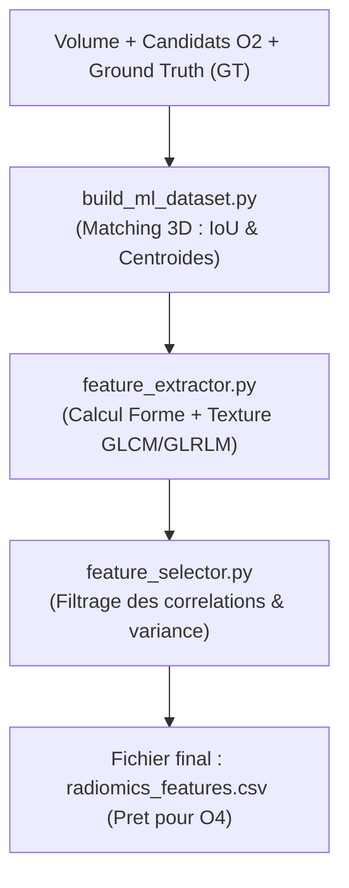

# 📌 Module O3 : Extraction Radiomique & Construction du Dataset ML

---

## 💡 Le Module O3 en 2 Mots (Pour tous)

Si le scanner est une photographie 3D, la **Radiomique** est une **loupe mathématique ultra-puissante**. Elle traduit des formes et des textures complexes (que l'œil humain ne peut pas quantifier précisément) en une série de **signatures numériques** (chiffres).

Le **Module O3** analyse chaque candidat extrait par O2, calcule ses caractéristiques (rugosité, hétérogénéité, compacité, contraste), croise le tout avec le diagnostic de référence (Ground Truth) et produit un tableau Excel/CSV prêt à être appris par les algorithmes de Machine Learning (O4).

---

## 🎯 Enjeux & Rôle dans le Projet

* **Quantification Texturale 3D** : Une embolie réelle présente des textures pures et un gradient de gris spécifique (GLCM, GLRLM) très différent du sang circulant ou des parois bronchiques.
* **Superposition GT & Candidats (Label Matching)** : Le script `build_ml_dataset.py` vérifie mathématiquement l'intersection (IoU / distance centroïde) entre le masque vérité terrain (GT fourni par les radiologues) et les objets O2 :
  * **Classe 1 (Vrai Positif - VP)** : Candidat touchant la zone de l'embolie réelle.
  * **Classe 0 (Faux Positif - FP)** : Candidat généré par O2 qui s'avère être un vaisseau sain ou un artefact (Hard Negative).
* **Réduction de Dimensionnalité** : Filtrage des caractéristiques redondantes ou trop corrélées pour éviter le surapprentissage (overfitting).

---

## 📂 Contenu du Package `src/O3_radiomics/`

| Fichier Python | Rôle & Contenu Concret |
| :--- | :--- |
| [`feature_extractor.py`](file:///f:/Nouveau%20dossier/Projets/Projet_detection_embolie_pulmonaire/src/O3_radiomics/feature_extractor.py) | Calculateur principal de features radiomiques 3D (Forme, Intensité de 1er ordre, Matrices de texture GLCM/GLRLM/GLSZM). |
| [`build_ml_dataset.py`](file:///f:/Nouveau%20dossier/Projets/Projet_detection_embolie_pulmonaire/src/O3_radiomics/build_ml_dataset.py) | Orchestrateur du matching GT vs Candidats O2 et exportateur du jeu de données tabulaire équilibré. |
| [`extract_all.py`](file:///f:/Nouveau%20dossier/Projets/Projet_detection_embolie_pulmonaire/src/O3_radiomics/extract_all.py) | Script d'exécution batch automatisé parcourant l'intégralité du répertoire des patients (`PAT001` à `PATxxx`). |
| [`feature_selector.py`](file:///f:/Nouveau%20dossier/Projets/Projet_detection_embolie_pulmonaire/src/O3_radiomics/feature_selector.py) | Sélection de variables : supprime la variance nulle, élimine la colinéarité ($r > 0.90$) et sélectionne les meilleures variables (Mutual Info / Feature Importance). |

---

## 🔄 Pipeline d'Exécution



---

## 📥 Entrées & 📤 Sorties

* **Entrée** : `volume.npy`, `candidates.npy` (sorties O2) et `mask.npy` (vérité terrain GT).
* **Sortie** : Fichier CSV `data/processed/radiomics_features.csv` (ou `ml_dataset_balanced.csv`) contenant 50+ variables radiomiques par candidat et la colonne cible `has_embolism` (0 ou 1).

---

## 🚀 Exemple d'Utilisation Rapide

```python
from src.O3_radiomics.feature_extractor import EmbolismFeatureExtractor
from src.O3_radiomics.feature_selector import RadiomicsFeatureSelector

# 1. Extraire les caractéristiques d'une ROI candidat
extractor = EmbolismFeatureExtractor()
features = extractor.extract_from_roi(volume_3d, roi_mask_3d)

# 2. Filtrer les caractéristiques redondantes du dataframe
selector = RadiomicsFeatureSelector(correlation_threshold=0.90)
df_clean = selector.fit_transform(df_features, target_col='has_embolism')
```
