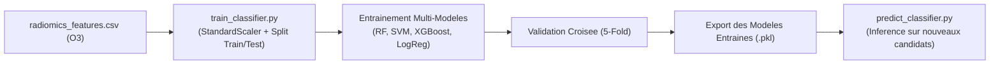

# 📌 Module O4 : Classificateurs de Machine Learning Classique

---

## 💡 Le Module O4 en 2 Mots (Pour tous)

Une fois les candidats transformés en chiffres par le Module O3, le **Module O4** est le **cerveau de décision statistique**. 

Il entraîne plusieurs algorithmes de Machine Learning (Forêts Aléatoires, SVM, XGBoost) à différencier en quelques millisecondes une **vraie embolie pulmonaire** d'un **faux positif** (vaisseau sain, branche bronchique, artefact de mouvement).

---

## 🎯 Enjeux & Rôle dans le Projet

* **Reconnaissance de Formes et Textures Tabulaires** : Contrairement aux réseaux de neurones profonds qui demandent des millions d'images, le Machine Learning classique excelle sur des tableaux de métriques radiomiques ciblées et permet d'obtenir des modèles très légers et réactifs.
* **Explicabilité & Modèles Comparés** : 
  * **Random Forest** : Modèle d'arbres de décision robuste, insensible au surapprentissage et fournissant l'importance exacte des caractéristiques.
  * **XGBoost** : Algorithme de gradient boosting ultra-performant sur données tabulaires déséquilibrées.
  * **SVM (Support Vector Machine)** : Recherche l'hyperplan optimal de séparation dans l'espace multidimensionnel.
  * **Régression Logistique & KNN** : Baselines rapides et interprétables.
* **Équilibrage & Normalisation** : Standardisation des valeurs (`StandardScaler`) et gestion du déséquilibre de classes.

---

## 📂 Contenu du Package `src/O4_classical_classifier/`

| Fichier Python | Rôle & Contenu Concret |
| :--- | :--- |
| [`train_classifier.py`](file:///f:/Nouveau%20dossier/Projets/Projet_detection_embolie_pulmonaire/src/O4_classical_classifier/train_classifier.py) | Classe `ClassicalClassifierTrainer` : charge le CSV, entraîne les 4 modèles (RF, SVM, LogReg, XGBoost) avec validation croisée (`StratifiedKFold`), évalue les métriques et sauvegarde le scaler et les modèles `.pkl`. |
| [`predict_classifier.py`](file:///f:/Nouveau%20dossier/Projets/Projet_detection_embolie_pulmonaire/src/O4_classical_classifier/predict_classifier.py) | Classe `ClassicalClassifierPredictor` : charge un modèle sérialisé (`.pkl`) et effectue l'inférence en temps réel sur les caractéristiques radiomiques de nouveaux candidats. |

---

## 🔄 Pipeline d'Exécution



---

## 📥 Entrées & 📤 Sorties

* **Entrée** : `data/processed/radiomics_features.csv` (fichier tabulaire généré par O3).
* **Sortie** : 
  * Fichiers modèles `.pkl` enregistrés dans `results/classical_classifier/models/` (ex: `best_random_forest.pkl`, `scaler.pkl`).
  * Rapports de métriques et prédictions de probabilité (ex: probabilité qu'un candidat soit une embolie de 0% à 100%).

---

## 🚀 Exemple d'Utilisation Rapide

```python
from src.O4_classical_classifier.train_classifier import ClassicalClassifierTrainer
from src.O4_classical_classifier.predict_classifier import ClassicalClassifierPredictor

# 1. Entraîner et comparer tous les modèles ML
trainer = ClassicalClassifierTrainer(features_path="data/processed/radiomics_features.csv")
df_data, labels = trainer.load_data()
results = trainer.train_all_models()

# 2. Utiliser le meilleur modèle pour prédire un nouveau candidat
predictor = ClassicalClassifierPredictor(models_dir="results/classical_classifier/models")
pred_class, proba = predictor.predict_single_candidate(new_candidate_features)
print(f"Prédiction : {pred_class} (Probabilité EP : {proba:.2%})")
```
