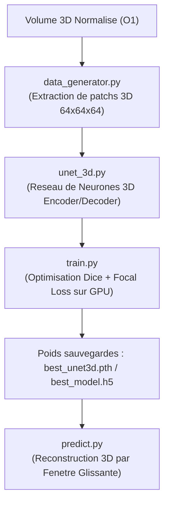

# 📌 Module O5 : Deep Learning & Segmentation 3D U-Net

---

## 💡 Le Module O5 en 2 Mots (Pour tous)

Contrairement au Machine Learning classique (O3+O4) qui nécessite d'extraire manuellement des formes et des textures, le **Deep Learning (O5)** agit comme un **œil d'expert médical virtuel**. 

Il parcourt l'intégralité du volume scanner en 3D tranche par tranche grâce à un réseau de neurones artificiels nommé **U-Net 3D**, qui apprend de lui-même à détecter et contourner automatiquement l'emplacement exact des caillots sanguins au millimètre près (analyse au niveau voxel).

---

## 🎯 Enjeux & Rôle dans le Projet

* **Segmentation Voxel-Level Précise** : Produit une carte de probabilité 3D où chaque sous-élément (voxel) du poumon reçoit un score indiquant s'il appartient à une embolie ou au tissu sain.
* **Architecture U-Net 3D** :
  * **Encoder (Contraction)** : Capture le contexte anatomique global et la géométrie des artères.
  * **Decoder (Expansion)** : Restaure la résolution spatiale fine pour délimiter les contours exacts de la lésion.
  * **Skip Connections** : Transfèrent les détails haute résolution de l'encodeur vers le décodeur sans perte d'information spatiale.
* **Détection Directe Sans Étape de Candidats** : Le U-Net 3D peut prédire l'embolie directement sur le volume normalisé sans dépendre du filtre classique O2.

---

## 📂 Contenu du Package `src/O5_deep_learning/`

| Fichier Python | Rôle & Contenu Concret |
| :--- | :--- |
| [`unet_3d.py`](file:///f:/Nouveau%20dossier/Projets/Projet_detection_embolie_pulmonaire/src/O5_deep_learning/unet_3d.py) | Architecture complète du **U-Net 3D** (Blocs `Conv3D`, `BatchNormalization`, `Dropout`, `UpSampling3D` et connexions saautées). |
| [`cnn_2d.py`](file:///f:/Nouveau%20dossier/Projets/Projet_detection_embolie_pulmonaire/src/O5_deep_learning/cnn_2d.py) | Modèle CNN 2D pour la détection coupe par coupe (approche baseline ultra-rapide). |
| [`cnn_3d.py`](file:///f:/Nouveau%20dossier/Projets/Projet_detection_embolie_pulmonaire/src/O5_deep_learning/cnn_3d.py) | ResNet 3D / Classifier CNN 3D pour la classification de sous-volumes (patchs 3D). |
| [`data_generator.py`](file:///f:/Nouveau%20dossier/Projets/Projet_detection_embolie_pulmonaire/src/O5_deep_learning/data_generator.py) | Générateur de données en streaming (`Dataset` / `Sequence`) gérant le chargement continu des patchs 3D `.npy` sur RAM/GPU. |
| [`train.py`](file:///f:/Nouveau%20dossier/Projets/Projet_detection_embolie_pulmonaire/src/O5_deep_learning/train.py) | Script principal d'entraînement (Loss mixte Dice + Focal Loss, Early Stopping, enregistrement du meilleur modèle `.pth` / `.h5`). |
| [`predict.py`](file:///f:/Nouveau%20dossier/Projets/Projet_detection_embolie_pulmonaire/src/O5_deep_learning/predict.py) | Moteur d'inférence 3D par fenêtres glissantes (*sliding window*) reconstruisant le masque binaire final du patient. |

---

## 🔄 Pipeline d'Exécution



---

## 📥 Entrées & 📤 Sorties

* **Entrée** : Volumes 3D `.npy` rééchantillonnés et masques Ground Truth correspondants.
* **Sortie** : 
  * Poids du modèle entraîné (`best_unet3d.pth` ou `best_model.h5`).
  * Volume 3D prédictif (`pred_mask.npy`) contenant les probabilités voxéliques entre 0.0 et 1.0.

---

## 🚀 Exemple d'Utilisation Rapide

```python
from src.O5_deep_learning.unet_3d import build_unet_3d
from src.O5_deep_learning.predict import DeepLearningPredictor

# 1. Instancier le modèle U-Net 3D
model = build_unet_3d(input_shape=(64, 64, 64, 1), num_classes=1)

# 2. Réaliser la prédiction 3D sur un patient complet
predictor = DeepLearningPredictor(model_path="models/deep_learning/best_unet3d.pth")
predicted_mask_3d = predictor.predict_volume(patient_volume_npy)
```
