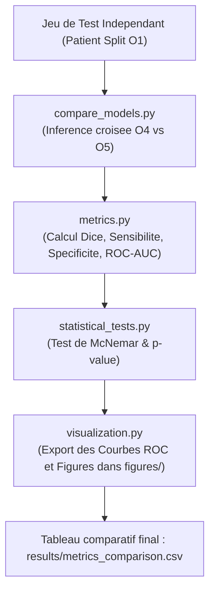

# 📌 Module O6 : Évaluation Rigoureuse & Comparaison des Modèles

---

## 💡 Le Module O6 en 2 Mots (Pour tous)

Construire des IA ne suffit pas, il faut **prouver scientifiquement quelle méthode est la meilleure et la plus sûre pour les patients**. 

Le **Module O6** agit comme un **bureau de contrôle indépendant** : il soumet le Machine Learning classique (O4) et le Deep Learning 3D (O5) à un examen rigoureux sur un jeu de données de test inédit, calcule les métriques médicales (Dice, Sensibilité, Spécificité) et effectue des tests statistiques pour certifier les résultats.

---

## 🎯 Enjeux & Rôle dans le Projet

* **Sensibilité Médicale Prioritaire (Recall)** : En urgence médicale, rater une embolie pulmonaire (Faux Négatif) peut être fatal. La priorité absolue est de maximiser le taux de détection (Sensibilité > 90%) tout en gardant un nombre de faux positifs acceptable.
* **Score Dice & IoU (Segmentation 3D)** : Mesure le chevauchement exact entre la lésion réelle dessinée par le radiologue et le masque produit par l'IA.
* **Tests de Significativité Statistique** : Détermine grâce au test de **McNemar** et aux tests t-pairement ajustés si la supériorité d'un modèle par rapport à un autre est un hasard statistique ou une vraie avancée.

---

## 📂 Contenu du Package `src/O6_evaluation/`

| Fichier Python | Rôle & Contenu Concret |
| :--- | :--- |
| [`metrics.py`](file:///f:/Nouveau%20dossier/Projets/Projet_detection_embolie_pulmonaire/src/O6_evaluation/metrics.py) | Calculateur des métriques : Score Dice, IoU, Sensibilité/Rappel, Spécificité, Précision, F1-Score, ROC-AUC et Matrice de Confusion. |
| [`compare_models.py`](file:///f:/Nouveau%20dossier/Projets/Projet_detection_embolie_pulmonaire/src/O6_evaluation/compare_models.py) | Classe `ModelComparator` : orchestre la prédiction de tous les modèles O4 et O5 sur le jeu de test et génère un tableau synthétique comparative. |
| [`statistical_tests.py`](file:///f:/Nouveau%20dossier/Projets/Projet_detection_embolie_pulmonaire/src/O6_evaluation/statistical_tests.py) | Réalise les tests de McNemar et de Student/Wilcoxon pour valider la significativité statistique ($p < 0.05$). |
| [`visualization.py`](file:///f:/Nouveau%20dossier/Projets/Projet_detection_embolie_pulmonaire/src/O6_evaluation/visualization.py) | Génère et sauvegarde les graphiques haute définition : Courbes ROC, Courbes Précision-Rappel, matrices de confusion et barplots comparatifs. |

---

## 🔄 Pipeline d'Exécution



---

## 📥 Entrées & 📤 Sorties

* **Entrée** : Prédictions des modèles O4 (`.pkl`) et O5 (`.pth` / `.h5`) sur le sous-ensemble de Test.
* **Sortie** : 
  * `results/metrics_comparison.csv` : Tableau comparatif global des performances.
  * Graphiques dans `figures/` (`roc_curves.png`, `confusion_matrix_unet3d.png`).

---

## 🚀 Exemple d'Utilisation Rapide

```python
from src.O6_evaluation.compare_models import ModelComparator
from src.O6_evaluation.metrics import calculate_all_metrics

# 1. Comparer l'ensemble des modèles sur le test set
comparator = ModelComparator(config_path="config.yaml")
df_results = comparator.evaluate_all(test_data_path="data/processed/test_split")
print(df_results)

# 2. Obtenir les métriques détaillées d'une segmentation
metrics = calculate_all_metrics(y_true_mask, y_pred_mask)
print(f"Score Dice : {metrics['dice']:.4f} | Sensibilité : {metrics['sensitivity']:.4f}")
```
