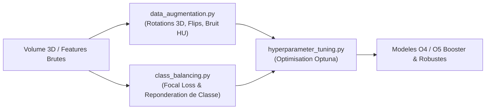

# 📌 Module O7 : Optimisation, Augmentation 3D & Équilibrage

---

## 💡 Le Module O7 en 2 Mots (Pour tous)

En imagerie médicale, les données sont souvent rares et le problème est très déséquilibré : un scanner comporte des millions de voxels sains pour seulement quelques centaines de voxels d'embolie. 

Le **Module O7** agit comme une **salle d'entraînement et d'amplification** pour l'IA : 
1. Il applique des **mutations virtuelles 3D** (rotations, zooms, ajustement du contraste) pour multiplier virtuellement les cas d'apprentissage.
2. Il repondère l'attention des modèles pour qu'ils ne se concentrent pas uniquement sur le tissu sain.

---

## 🎯 Enjeux & Rôle dans le Projet

* **Augmentation de Données 3D Spécifique à la Radiologie** : Contrairement aux images classiques (photos 2D), les volumes 3D CTPA nécessitent des transformations préservant l'anatomie (rotations 3D légères, flips anatomiques, variations du bruit de fond du scanner).
* **Gestion du Déséquilibre Majeur (Class Imbalance)** :
  * **Losses Adaptées (Focal Loss + Dice Loss)** : La *Focal Loss* pénalise l'erreur sur les exemples difficiles (embolies) et ignore les voxels faciles (fond vide).
  * **Rééchantillonnage Tabulaire (SMOTE / Undersampling)** : Pour le ML classique (O4), rééquilibre les classes 0 (FP) et 1 (VP).
* **Réglage Automatisé des Hyperparamètres** : Optimisation par Optuna ou GridSearch pour identifier le meilleur taux d'apprentissage (*learning rate*), la profondeur des réseaux ou le nombre d'arbres.

---

## 📂 Contenu du Package `src/O7_optimization/`

| Fichier Python | Rôle & Contenu Concret |
| :--- | :--- |
| [`data_augmentation.py`](file:///f:/Nouveau%20dossier/Projets/Projet_detection_embolie_pulmonaire/src/O7_optimization/data_augmentation.py) | Générateur de transformations 3D (Rotations 3D axes X/Y/Z, flips, bruits gaussiens, ajustements de contraste HU, déformations élastiques). |
| [`class_balancing.py`](file:///f:/Nouveau%20dossier/Projets/Projet_detection_embolie_pulmonaire/src/O7_optimization/class_balancing.py) | Implémentation des fonctions de perte pondérées (Focal Loss, Weighted Cross-Entropy) et techniques de sur-échantillonnage SMOTE 3D. |
| [`hyperparameter_tuning.py`](file:///f:/Nouveau%20dossier/Projets/Projet_detection_embolie_pulmonaire/src/O7_optimization/hyperparameter_tuning.py) | Pipelines d'optimisation d'hyperparamètres automatisées (Optuna / RandomSearchCV) pour calibrer O4 et O5. |

---

## 🔄 Pipeline d'Exécution



---

## 📥 Entrées & 📤 Sorties

* **Entrée** : Batches de volumes 3D / masques ou tableaux de features O3.
* **Sortie** : Volumes augmentés dynamiquement en mémoire lors du streaming PyTorch/Keras et hyperparamètres optimisés (`best_params.json`).

---

## 🚀 Exemple d'Utilisation Rapide

```python
from src.O7_optimization.data_augmentation import augment_volume_3d
from src.O7_optimization.class_balancing import FocalLoss

# 1. Appliquer une augmentation 3D aléatoire sur un volume
aug_vol, aug_mask = augment_volume_3d(volume_3d, mask_3d, rotation_range=15, flip_prob=0.5)

# 2. Utiliser la Focal Loss pour l'entraînement PyTorch
criterion = FocalLoss(alpha=0.25, gamma=2.0)
loss = criterion(predictions, targets)
```
