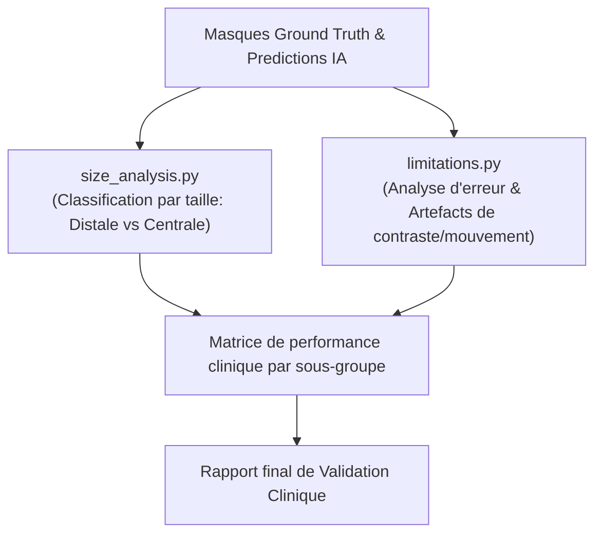

# 📌 Module O8 : Validation Clinique & Analyse des Limites

---

## 💡 Le Module O8 en 2 Mots (Pour tous)

Une métrique globale (comme un chiffre d'exactitude à 95%) peut masquer des réalités médicales cruciales. Une petite embolie tout au bout d'un petit vaisseau est bien plus difficile à voir qu'un gros caillot bloquant l'artère principale.

Le **Module O8** agit comme le **comité médical d'évaluation** : il dissèque la performance de l'IA en fonction de la taille réelle des caillots et de leur localisation anatomique, tout en répertoriant clairement les limites de la solution face aux artefacts d'imagerie.

---

## 🎯 Enjeux & Rôle dans le Projet

* **Analyse Stratifiée par Taille de Lésion** :
  * **Embolies Centrales & Lobaires (Volumineuses)** : Gravité extrême (urgence vitale immédiate), la sensibilité du modèle doit être de 100%.
  * **Embolies Segmentaires & Sous-Segmentaires (Distales / Petites)** : Défi technique en imagerie, le module évalue si l'IA maintient une détection fiable sur les lésions $< 5\text{ mm}^3$.
* **Audit des Artefacts Cliniques & Cas d'Échec** :
  * Artefacts de mouvement cardiaque/respiratoire (bruit au niveau des bases pulmonaires).
  * Timing d'injection du produit de contraste (opacification artérielle insuffisante).
* **Consolidations pour les Cliniciens** : Fournir aux radiologues un rapport clair d'applicabilité et de confiance pour une utilisation en pratique courante.

---

## 📂 Contenu du Package `src/O8_clinical_validation/`

| Fichier Python | Rôle & Contenu Concret |
| :--- | :--- |
| [`size_analysis.py`](file:///f:/Nouveau%20dossier/Projets/Projet_detection_embolie_pulmonaire/src/O8_clinical_validation/size_analysis.py) | Module de segmentation et catégorisation des embolies selon leur volume 3D (Petites, Moyennes, Grandes) et calcul de la sensibilité stratifiée. |
| [`limitations.py`](file:///f:/Nouveau%20dossier/Projets/Projet_detection_embolie_pulmonaire/src/O8_clinical_validation/limitations.py) | Analyse des erreurs systématiques (Faux Positifs récurrents dus aux ganglions ou mucus bronchique, Faux Négatifs sur vaisseaux très distaux). |

---

## 🔄 Pipeline d'Exécution



---

## 📥 Entrées & 📤 Sorties

* **Entrée** : Masques prédictifs 3D et vérités terrains accompagnés des métadonnées de volume et localisation.
* **Sortie** : Rapports de stratification clinique (`results/clinical_validation_summary.json` et graphiques de sensibilité vs taille de lésion).

---

## 🚀 Exemple d'Utilisation Rapide

```python
from src.O8_clinical_validation.size_analysis import evaluate_by_lesion_size
from src.O8_clinical_validation.limitations import analyze_false_positives

# 1. Évaluer la sensibilité selon la taille des embolies
size_performance = evaluate_by_lesion_size(y_true_masks, y_pred_masks)
print("Sensibilité Embolies Centrales :", size_performance['central_sensitivity'])
print("Sensibilité Embolies Distales :", size_performance['distal_sensitivity'])

# 2. Identifier les sources majeures de faux positifs
fp_report = analyze_false_positives(y_true_masks, y_pred_masks, raw_volumes)
```
